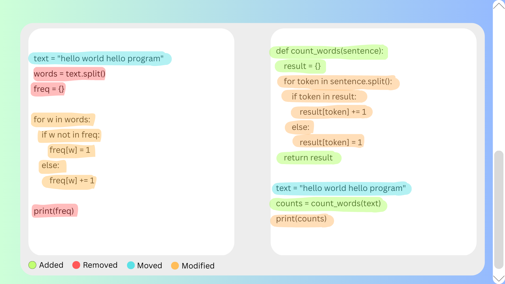

# LHDiff — Source Code Line Mapping and Change Tracking

A Python project for tracking how individual lines correspond between two versions of a file, including edited, moved, split, and merged lines.

## Overview

Understanding how code evolves can help with maintenance, debugging, and code review. A line may move or change while still corresponding to a line in an earlier version. LHDiff explores this problem by combining textual, structural, and surrounding-context similarity.

This repository contains our implementation, comparison scripts, a team-created dataset of 25 old/new file pairs, expected mappings, a technical report, and interface mockups.

## Research attribution

Our course project is informed by the published **LHDiff** research of Muhammad Asaduzzaman, Chanchal K. Roy, Kevin A. Schneider, and Massimiliano Di Penta:

*LHDiff: A Language-Independent Hybrid Approach for Tracking Source Code Lines*, ICSM 2013.

[Read the research paper](https://www.cs.usask.ca/~croy/papers/2013/LHDiffFullPaper-preprint.pdf)

This repository presents our coursework implementation and evaluation informed by that research.

## How the implementation works

1. **Preprocess lines:** lowercase text, remove most punctuation while retaining braces, and collapse whitespace. Blank lines are excluded from mapping output.
2. **Identify unchanged lines:** use Python's `difflib.SequenceMatcher` to match equal sequences after preprocessing.
3. **Generate candidates:** use SimHash over structural tokens to shortlist potential matches for remaining lines.
4. **Score candidates:** combine normalized Levenshtein similarity of line content (50%), structural similarity (30%), and cosine similarity of surrounding context (20%).
5. **Build mappings:** select primary matches and apply neighbouring-line heuristics to identify possible splits and merges.
6. **Report changes:** print line correspondences, unmatched old lines, and unmatched new lines.

The structural representation preserves a small keyword set and replaces other tokens with identifier or numeric placeholders. It does not use a full language parser or establish semantic equivalence.

## Quick start

The main implementation uses **Python 3 and its standard library**. No third-party packages are required for the command below.

```bash
git clone https://github.com/salmanyoussef/LHD.git
cd LHD
python3 LHDiff/LHDiff.py our-dataset/file17-old.txt our-dataset/file17-new.txt
```

Replace the final two arguments with paths to your own UTF-8 text files. Line numbers in the output start at **1** and refer to the original files.

### Repeatable example

The implementation currently uses Python's built-in `hash()` inside SimHash. Because Python normally randomizes string hashing between processes, candidate rankings can vary. On macOS/Linux, fix the seed when comparing runs:

```bash
PYTHONHASHSEED=0 python3 LHDiff/LHDiff.py our-dataset/file17-old.txt our-dataset/file17-new.txt
```

Example output for the included file pair with the fixed hash seed:

```text
1 -> 1
2 -> 12
3 -> 13
4 -> 3
5 -> 4
6 -> 5
7 -> 6
8 -> 7, 8
9 -> 7, 8
10 -> 15
11 -> 16, 17
12 -> 16, 17

# Unmatched deletions (only in OLD file):
(none)

# Unmatched additions (only in NEW file):
NEW 2
NEW 9
NEW 10
NEW 14
```

For example, `2 -> 12` means old line 2 was mapped to new line 12. A comma-separated list identifies multiple new lines associated with an old line. These are algorithm predictions; a successful run does not establish that every mapping is correct.

## Repository structure

| Path | Contents |
| --- | --- |
| `LHDiff/LHDiff.py` | Main Python line-mapping implementation and command-line interface |
| `our-dataset/` | 25 old/new file pairs and corresponding `matchings*.txt` files |
| `BEST/`, `GIT/`, `diff/`, `ldiff/`, `SCAM/` | Coursework comparison scripts and supporting material |
| `LHDiffReport.docx` | Group report describing the approach and evaluation |
| `Introduce-The-Project-Members.pptx` | Project and team introduction |
| `LHDiff/*.png` | Interface mockups illustrating the proposed application |

## Evaluation and limitations

The group report describes approximately **92% correctly identified line mappings** on the team's **25-pair dataset**, assessed against manually verified mappings. This is a coursework result on a small, team-created dataset, not a general accuracy guarantee. The repository does not currently include an automated scoring workflow that independently reproduces that figure.

The command-line implementation is available. The interface images below are **design mockups**, not screenshots of a working graphical application.

Other limitations include heuristic thresholds, simplified structural tokens, process-dependent hashing unless a seed is fixed, and limited validation on large or independently sourced datasets.

## Interface mockups

### Selecting file versions


### Visualising changes



## Team and contributions

**Albert Qyli, Salman Youssef, Omar Kayali, Badr Kayyali, and Youcef Teffahi.**

The project was a collaborative group effort.

## Possible next steps

- Replace Python's built-in hashing with a stable hash for reproducible SimHash generation.
- Add automated scoring against expected mappings, including explicit treatment of split and merged lines.
- Evaluate on independently sourced changes and larger files.
- Implement and test a graphical interface based on the existing mockups.
